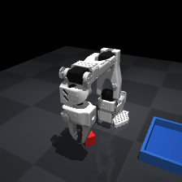
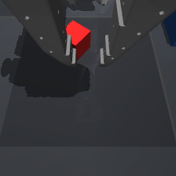
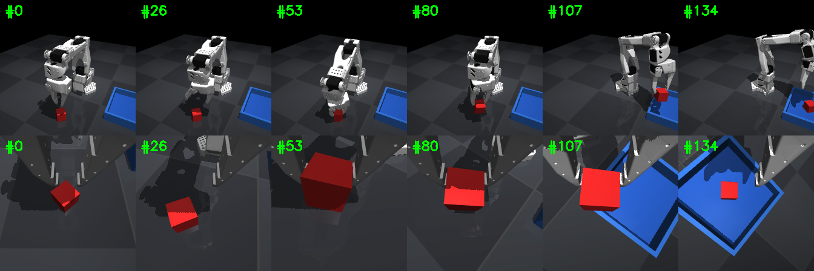
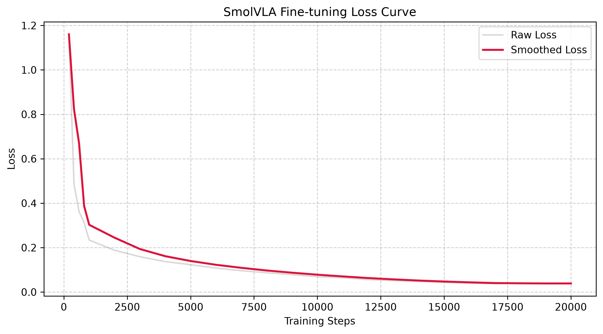

# SmolVLA Tuning Practice

实验设定：

1. 机械臂型号为 SO-100，形态上稍微有点非对称，也是一个难点
2. 一个全局相机 + 腕部相机 (缺失的部分用 LeRobot 官方接口进行空填充)

3. 专家采样100条数据，80条训练，20条验证；一条数据切片如下

4. 训练批量大小为64，执行 20,000 次梯度更新

实验结果：

50 轮测试，随机种子从 1000 到 1049，最终成功率为 44% (22/50)

绝大部分失败是机械臂没有成功抓取方块：机械臂和方块的对齐有细微的偏差，大部分失败案例都是机械臂的夹爪与方块顶部发生了不必要的碰撞

